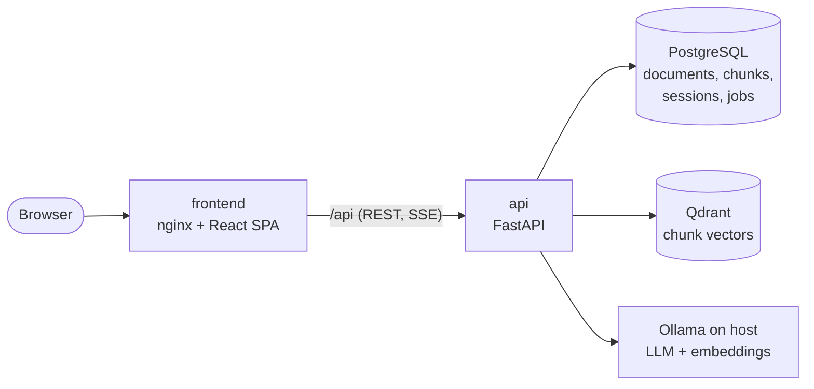

# Architecture

All services except Ollama run in Docker Compose. Ollama runs on the host ([ADR 0001](decisions/0001-ollama-on-host.md)).

## Backend modules (planned)

| Module | Responsibility | Milestone |
|---|---|---|
| `app/api` | HTTP routes and request/response schemas | M1+ |
| `app/core` | settings, logging | M1 |
| `app/db` | SQLAlchemy models, sessions; migrations in `alembic/` | M1–M2 |
| `app/ingestion` | parse → clean → chunk → embed → upsert | M2 |
| `app/providers` | `LLM` / `Embedder` protocols with Ollama, OpenAI-compatible and fake implementations | M2–M3 |
| `app/retrieval` | query rewriting, vector (later hybrid) search, reranking, confidence gate | M3, M7 |
| `app/generation` | prompt assembly, streaming, citation mapping | M3, M5 |
| `app/prompts` | versioned prompt files | M3 |

## Data ownership

PostgreSQL is the source of truth; Qdrant is a derived index that can be rebuilt from it ([ADR 0002](decisions/0002-postgres-source-of-truth.md)).

## Health

- `GET /api/health`: the process is alive (Docker health check).
- `GET /api/health/ready`: per-component status for Postgres, Qdrant and Ollama, including missing models. Returns 503 with details when degraded, so the UI can show what is wrong.
